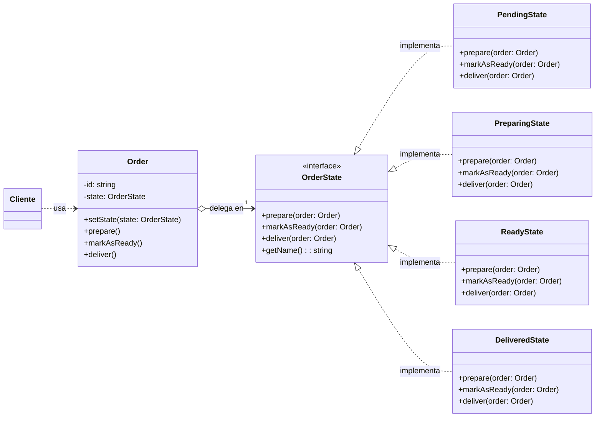
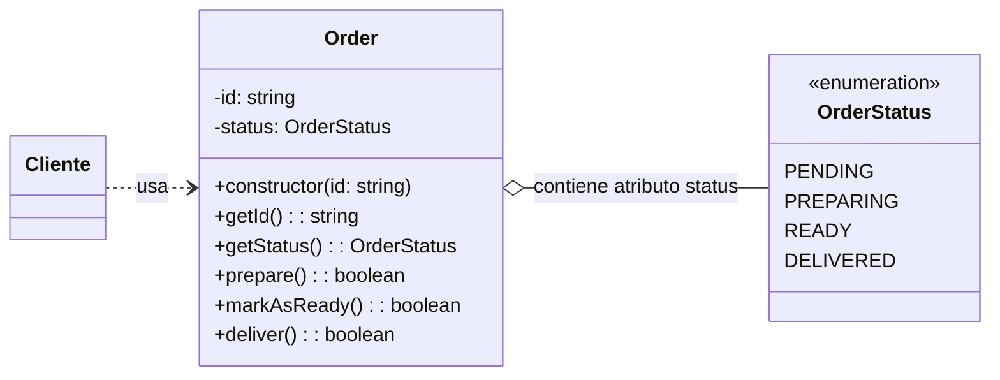
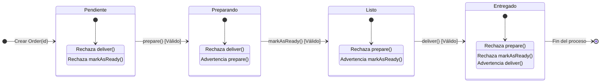

# Caso Práctico: Patrón de Diseño State (Estado)
## Sistema de Gestión de Pedidos de Comida para Restaurante

> **Asignatura:** Patrones de Diseño de Software  
> **Nivel:** 9° Semestre - Ingeniería de Sistemas / Software  
> **Lenguaje:** TypeScript  

---

## 1. Descripción del problema

En el sector gastronómico, la administración y trazabilidad de los pedidos de comida es crítica. Un pedido no es un elemento estático: desde el instante en que el comensal lo solicita hasta que lo recibe en su mesa o domicilio, atraviesa una serie de etapas bien definidas con reglas de negocio estrictas:

1. **Pendiente (`PendingState`):** La orden fue tomada por el mesero o recibida por la aplicación y está en espera de ser atendida por la cocina.
2. **Preparando (`PreparingState`):** El equipo de cocina ha iniciado la cocción y ensamble de los platillos.
3. **Listo (`ReadyState`):** Los platillos han sido cocinados, emplatados y empacados; esperan ser recogidos por el mesero o repartidor.
4. **Entregado (`DeliveredState`):** El cliente ha recibido su comida a satisfacción. El ciclo de vida del pedido ha concluido formalmente.

### El conflicto del negocio
Cada etapa o estado determina **qué operaciones están permitidas y cuáles deben ser rechazadas**:
- No es admisible entregar un pedido que apenas está *Pendiente* o que todavía se está *Preparando* (no se puede entregar comida cruda o a medio cocinar).
- No se puede marcar como *Listo* un pedido que ni siquiera ha comenzado a prepararse.
- Una vez *Entregado*, el pedido no puede volver a prepararse ni volver a pasar por las etapas anteriores.

Cuando este comportamiento se programa de manera tradicional (sin patrones de diseño), se suele recurrir a una única clase con múltiples variables de estado e interminables bloques condicionales (`if / else if` o `switch`). A medida que surgen nuevos estados o reglas, esta clase se transforma en un **antipatrón "God Object"**, altamente acoplado, frágil y difícil de mantener.

---

## 2. Objetivo del proyecto

1. **Demostrar de forma práctica y funcional** cómo el patrón de diseño de comportamiento **State (Estado)** permite que un objeto (`Order`) modifique dinámicamente su comportamiento en tiempo de ejecución al cambiar su estado interno.
2. **Evidenciar el problema del diseño sin State**, documentando el sobrepeso de condicionales y la violación de principios SOLID (específicamente SRP y OCP).
3. **Implementar el patrón State en TypeScript**, estructurando las clases bajo los roles de **Context**, **State (Interface)** y **ConcreteStates**.
4. **Validar las transiciones permitidas y el rechazo controlado de operaciones inválidas**, ofreciendo una suite de pruebas automatizadas y salidas explicativas por consola para exposición académica universitaria.

---

## 3. Explicación del Patrón State

El patrón **State** es un patrón de diseño de comportamiento catalogado por el *Gang of Four (GoF)*.

### Propósito
Permite que un objeto altere su comportamiento cuando su estado interno cambia. Desde la perspectiva del cliente, pareciera como si el objeto hubiera cambiado de clase.

### Mecánica fundamental
En lugar de que un objeto almacene un atributo primitivo (un string o un número) y verifique con `if/switch` qué hacer en cada método:
1. Se extrae cada comportamiento específico de cada estado a una clase independiente (**ConcreteState**).
2. Todos los estados implementan una interfaz común (**State**).
3. El objeto original (**Context**) delega la ejecución de sus métodos al objeto de estado actual.
4. Las transiciones de estado ocurren reemplazando la referencia del objeto de estado en el contexto (`order.setState(new NextState())`).

### Beneficios clave
- **Principio de Responsabilidad Única (SRP):** Cada estado encapsula únicamente las reglas y comportamientos pertinentes a dicha fase.
- **Principio Abierto/Cerrado (OCP):** Es posible añadir nuevos estados (por ejemplo, *Cancelado*, *En Reparto*, *Devuelto*) creando nuevas clases sin modificar las existentes ni alterar el contexto `Order`.
- **Eliminación del "Espagueti" de Condicionales:** Se erradican las estructuras `switch` o `if/else` gigantes distribuidas en múltiples métodos.

---

## 4. Estructura de carpetas

El proyecto cuenta con una separación arquitectónica limpia y modular:

```text
Patron-state/
├── diagrams/                          # Diagramas UML en PlantUML
│   ├── 01-without-state.puml          # Diagrama de la versión sin State
│   ├── 02-with-state.puml             # Diagrama de la versión aplicando State
│   └── 03-state-transitions.puml     # Diagrama de máquina de estados
├── src/
│   ├── without-state/                 # IMPLEMENTACIÓN 1: Sin State (Monolítica)
│   │   ├── OrderStatus.ts             # Enumeración de estados
│   │   ├── Order.ts                   # Clase monolítica con if/else acumulados
│   │   └── index.ts                   # Demostración en consola sin State
│   ├── with-state/                    # IMPLEMENTACIÓN 2: Con Patrón State (GoF)
│   │   ├── Order.ts                   # Contexto: delega en el estado actual
│   │   ├── OrderState.ts              # Interfaz común de los estados
│   │   ├── PendingState.ts            # Estado concreto: Pendiente
│   │   ├── PreparingState.ts          # Estado concreto: Preparando
│   │   ├── ReadyState.ts              # Estado concreto: Listo
│   │   ├── DeliveredState.ts          # Estado concreto: Entregado
│   │   └── index.ts                   # Demostración en consola con State
│   ├── tests/                         # Pruebas automatizadas (40 aserciones)
│   │   ├── without-state.test.ts      # Pruebas de la versión sin State
│   │   ├── with-state.test.ts         # Pruebas de la versión con State
│   │   └── run-all-tests.ts           # Runner principal de pruebas
│   └── index.ts                       # Punto de entrada comparativo general
├── dist/                              # Código JavaScript compilado (tsc)
├── package.json                       # Configuración y scripts npm
├── tsconfig.json                      # Configuración de compilación TypeScript
└── README.md                          # Documentación completa académica
```

---

## 5. Primera implementación: SIN aplicar State

En la carpeta [`src/without-state/`](file:///c:/Users/David%20Palomino%20Ochoa/Documents/9%20SEMESTRE/Patrones%20de%20diseño/Patron-state/src/without-state), la clase [`Order`](file:///c:/Users/David%20Palomino%20Ochoa/Documents/9%20SEMESTRE/Patrones%20de%20diseño/Patron-state/src/without-state/Order.ts) almacena una variable `status: OrderStatus` y cada método (`prepare()`, `markAsReady()`, `deliver()`) evalúa el estado mediante condicionales:

```typescript
// Fragmento de src/without-state/Order.ts
public prepare(): boolean {
  if (this.status === OrderStatus.PENDING) {
    this.status = OrderStatus.PREPARING;
    return true;
  } else if (this.status === OrderStatus.PREPARING) {
    // Advertencia: ya preparando
    return false;
  } else if (this.status === OrderStatus.READY) {
    // Error: ya cocinado
    return false;
  } else if (this.status === OrderStatus.DELIVERED) {
    // Error: ciclo concluido
    return false;
  }
  return false;
}
```

### Limitaciones técnicas documentadas
1. **Concentración de responsabilidades (God Class):** La clase `Order` debe conocer el ciclo de vida completo del restaurante, cómo preparar, cómo empacar y cómo entregar.
2. **Acumulación exponencial de condicionales:** Si existen 4 métodos y 4 estados, se tienen al menos 16 ramificaciones condicionales. Si se añaden 2 estados más (*Cancelado*, *Reembolsado*), hay que revisar y modificar **todos** los métodos.
3. **Violación del Principio Abierto/Cerrado (OCP):** El código existente debe abrirse para modificación cada vez que una regla de negocio cambie.
4. **Alta probabilidad de efectos secundarios:** Modificar una condición para un estado puede romper accidentalmente el flujo de otro estado no relacionado.

---

## 6. Segunda implementación: APLICANDO State

En la carpeta [`src/with-state/`](file:///c:/Users/David%20Palomino%20Ochoa/Documents/9%20SEMESTRE/Patrones%20de%20diseño/Patron-state/src/with-state), el problema se resuelve descomponiendo el comportamiento en objetos polimórficos.

### Contrato común (`OrderState.ts`)
```typescript
export interface OrderState {
  prepare(order: Order): void;
  markAsReady(order: Order): void;
  deliver(order: Order): void;
  getName(): string;
}
```

### Contexto limpio (`Order.ts`)
La clase contexto no tiene ni un solo `if` o `switch` sobre el estado del pedido:
```typescript
export class Order {
  private id: string;
  private state: OrderState;

  constructor(id: string, initialState?: OrderState) {
    this.id = id;
    this.state = initialState ?? new PendingState();
  }

  public setState(state: OrderState): void {
    this.state = state;
  }

  public prepare(): void {
    this.state.prepare(this); // Delegación total
  }

  public markAsReady(): void {
    this.state.markAsReady(this); // Delegación total
  }

  public deliver(): void {
    this.state.deliver(this); // Delegación total
  }
}
```

---

## 7. Explicación de Context, State y ConcreteState



### 1. Context (`Order`)
- Es la interfaz principal que consume el cliente.
- Posee los atributos de identidad del pedido (`id`) y la referencia privada a su estado (`state: OrderState`).
- Expone los métodos de negocio (`prepare()`, `markAsReady()`, `deliver()`) delegando directamente en `this.state.metodo(this)`.
- Ofrece `setState(state: OrderState)` para permitir que los estados gestionen las transiciones.

### 2. State (`OrderState`)
- Interfaz que define el contrato común para todas las fases del pedido.
- Cada método recibe una referencia al contexto `Order`, lo que permite al estado acceder a la información del pedido o llamar a `order.setState(...)` cuando la transición es válida.

### 3. ConcreteStates (Estados Concretos)
- **`PendingState`:**
  - `prepare()`: Válido. Transiciona a `new PreparingState()`.
  - `markAsReady()` y `deliver()`: Rechazados con mensaje informativo (aún no se ha preparado).
- **`PreparingState`:**
  - `markAsReady()`: Válido. Transiciona a `new ReadyState()`.
  - `prepare()`: Rechazado/advertencia (ya está en cocción).
  - `deliver()`: Rechazado (la comida no está lista).
- **`ReadyState`:**
  - `deliver()`: Válido. Transiciona a `new DeliveredState()`.
  - `prepare()`: Rechazado (la comida ya está lista).
  - `markAsReady()`: Rechazado/advertencia (ya está marcado como listo).
- **`DeliveredState`:**
  - Es el estado terminal.
  - Todas las operaciones posteriores son rechazadas de forma controlada porque el ciclo del pedido ha terminado.

---

## 8. Diagramas UML

Los archivos fuente de PlantUML se encuentran en la carpeta [`diagrams/`](file:///c:/Users/David%20Palomino%20Ochoa/Documents/9%20SEMESTRE/Patrones%20de%20diseño/Patron-state/diagrams).

### Diagrama 1: Antes de aplicar State (Diseño Monolítico)
Archivo: [`diagrams/01-without-state.puml`](file:///c:/Users/David%20Palomino%20Ochoa/Documents/9%20SEMESTRE/Patrones%20de%20diseño/Patron-state/diagrams/01-without-state.puml)



> **Nota arquitectónica:** En este diseño inicial, toda la lógica de validación y cambio de estado se concentra en `Order` a través de múltiples condicionales encadenados.

---

### Diagrama 2: Después de aplicar el Patrón State (Diseño Polimórfico)
Archivo: [`diagrams/02-with-state.puml`](file:///c:/Users/David%20Palomino%20Ochoa/Documents/9%20SEMESTRE/Patrones%20de%20diseño/Patron-state/diagrams/02-with-state.puml)

```mermaid
classDiagram
    direction LR
    class Cliente {
    }

    class Order {
        <<Context>>
        -id: string
        -state: OrderState
        +constructor(id: string, initialState?: OrderState)
        +getId(): string
        +getState(): OrderState
        +getStateName(): string
        +setState(state: OrderState): void
        +prepare(): void
        +markAsReady(): void
        +deliver(): void
    }

    class OrderState {
        <<interface>>
        +prepare(order: Order): void
        +markAsReady(order: Order): void
        +deliver(order: Order): void
        +getName(): string
    }

    class PendingState {
        <<ConcreteState>>
        +prepare(order: Order): void
        +markAsReady(order: Order): void
        +deliver(order: Order): void
        +getName(): string
    }

    class PreparingState {
        <<ConcreteState>>
        +prepare(order: Order): void
        +markAsReady(order: Order): void
        +deliver(order: Order): void
        +getName(): string
    }

    class ReadyState {
        <<ConcreteState>>
        +prepare(order: Order): void
        +markAsReady(order: Order): void
        +deliver(order: Order): void
        +getName(): string
    }

    class DeliveredState {
        <<ConcreteState>>
        +prepare(order: Order): void
        +markAsReady(order: Order): void
        +deliver(order: Order): void
        +getName(): string
    }

    Cliente ..> Order : interactúa con
    Order o--> "1" OrderState : - state (delega operaciones)
    OrderState <|.. PendingState : implements
    OrderState <|.. PreparingState : implements
    OrderState <|.. ReadyState : implements
    OrderState <|.. DeliveredState : implements

    PendingState ..> PreparingState : transiciona a
    PreparingState ..> ReadyState : transiciona a
    ReadyState ..> DeliveredState : transiciona a

    PendingState ..> Order : invoca setState()
    PreparingState ..> Order : invoca setState()
    ReadyState ..> Order : invoca setState()
```



---

### Diagrama 3: Máquina de Estados del Pedido
Archivo: [`diagrams/03-state-transitions.puml`](file:///c:/Users/David%20Palomino%20Ochoa/Documents/9%20SEMESTRE/Patrones%20de%20diseño/Patron-state/diagrams/03-state-transitions.puml)



---

## 9. Instrucciones para ejecutar el proyecto

### Prerrequisitos
- Node.js versión 18+ (probado exitosamente en Node.js v24.15.0).
- npm versión 9+.

### Instalación de dependencias
En la raíz del proyecto, ejecutar:
```bash
npm install
```

### Scripts disponibles

1. **Compilar el proyecto con TypeScript (`tsc`):**
   ```bash
   npm run build
   ```

2. **Ejecutar la suite completa de pruebas automatizadas (40 pruebas):**
   ```bash
   npm test
   ```

3. **Ejecutar únicamente la demostración SIN State:**
   ```bash
   npm run demo:without-state
   ```

4. **Ejecutar únicamente la demostración CON State:**
   ```bash
   npm run demo:with-state
   ```

5. **Ejecutar la demostración general interactiva (Ambas versiones):**
   ```bash
   npm start
   ```

---

## 10. Resultados de las pruebas

La suite de pruebas automatizadas ([`src/tests/run-all-tests.ts`](file:///c:/Users/David%20Palomino%20Ochoa/Documents/9%20SEMESTRE/Patrones%20de%20diseño/Patron-state/src/tests/run-all-tests.ts)) evalúa 40 aserciones que verifican:

1. **Estado Inicial:** Comprobación de que todo nuevo pedido nace en estado `PENDIENTE` / `PendingState`.
2. **Transiciones Válidas:** Flujo exitoso completo `Pendiente -> Preparando -> Listo -> Entregado`.
3. **Rechazo de Transiciones Inválidas:**
   - Intentar `deliver()` en pedido pendiente.
   - Intentar `markAsReady()` en pedido pendiente.
   - Intentar `deliver()` mientras está en preparación.
   - Intentar `prepare()` cuando ya está listo.
   - Intentar `prepare()`, `markAsReady()` o `deliver()` una vez entregado.
4. **Conservación del Estado:** Se valida que ante cualquier operación rechazada, el estado permanece exactamente igual sin corromperse.
5. **Polimorfismo:** Se verifica la instanciación e inyección de estados concretos independientes.

### Resumen de ejecución en consola:
```text
================================================================
 SUITE DE PRUEBAS AUTOMATIZADAS - PATRÓN STATE EN RESTAURANTE
================================================================

--- Ejecutando pruebas: Implementación SIN State ---
  ✅ [PASS] Estado inicial debe ser PENDIENTE
  ✅ [PASS] No debe permitir deliver() desde PENDIENTE
  ✅ [PASS] El estado debe permanecer en PENDIENTE tras deliver() inválido
  ...
  ✅ [PASS] El estado debe mantenerse inalterable en ENTREGADO

--- Ejecutando pruebas: Implementación CON State ---
  ✅ [PASS] El estado inicial debe ser una instancia de PendingState
  ✅ [PASS] El nombre del estado inicial debe ser "Pendiente"
  ✅ [PASS] deliver() en Pendiente no debe alterar el estado
  ✅ [PASS] prepare() debe transicionar a PreparingState
  ✅ [PASS] markAsReady() debe transicionar a ReadyState
  ✅ [PASS] deliver() debe transicionar a DeliveredState
  ✅ [PASS] prepare() en Entregado no debe cambiar el estado
  ✅ [PASS] Debe responder polimórficamente al comportamiento de ReadyState

================================================================
 RESUMEN FINAL DE PRUEBAS
================================================================
Pruebas totales ejecutadas: 40
Pruebas exitosas (PASS)   : 40
Pruebas fallidas (FAIL)   : 0

🎉 ¡TODAS LAS PRUEBAS PASARON EXITOSAMENTE!
El comportamiento de las dos implementaciones es consistente.
```

---

## 11. Comparación de ambas implementaciones

| Criterio | Sin Patrón State | Con Patrón State |
| :--- | :--- | :--- |
| **Distribución de reglas** | Una sola clase (`Order`) concentra todas las reglas y validaciones. | Cada estado posee su propia clase independiente (`PendingState`, `PreparingState`, etc.). |
| **Manejo del comportamiento** | Se utilizan múltiples condicionales (`if / else if` o `switch`). | Se delega polimórficamente el comportamiento al objeto de estado actual. |
| **Escalabilidad (Añadir estados)** | Añadir un estado (*ej. Cancelado*) requiere modificar todos los métodos de `Order` (rompe OCP). | Se añade una nueva clase `CancelledState` que implementa `OrderState` sin alterar las demás. |
| **Complejidad ciclomática** | Muy alta; crece exponencialmente con cada nuevo estado u operación. | Mínima en cada clase; los métodos son concisos y atómicos. |
| **Cohesión y Acoplamiento** | Baja cohesión (God Object) y alto acoplamiento interno. | Alta cohesión (cada clase tiene una única razón para cambiar) y bajo acoplamiento. |
| **Principio SRP (SOLID)** | Violado. `Order` cambia por reglas de cocina, de empaque o de entrega. | Cumplido. Cada clase estado solo cambia si cambia su propia etapa. |
| **Principio OCP (SOLID)** | Violado. La clase principal debe modificarse para extenderse. | Cumplido. El contexto está cerrado a modificaciones pero abierto a extensiones. |

### Conclusión académica
La segunda implementación representa fielmente el patrón **State** porque:
1. No se limita a un simple enum o texto decorativo; los estados son **objetos de primera clase** con comportamiento real.
2. El contexto (`Order`) ignora las reglas internas de cada estado; solo sabe que su estado implementa `OrderState` y le delega el trabajo.
3. El cambio de comportamiento ocurre en tiempo de ejecución sustituyendo la instancia del estado, demostrando el verdadero poder del polimorfismo orientado a objetos.

